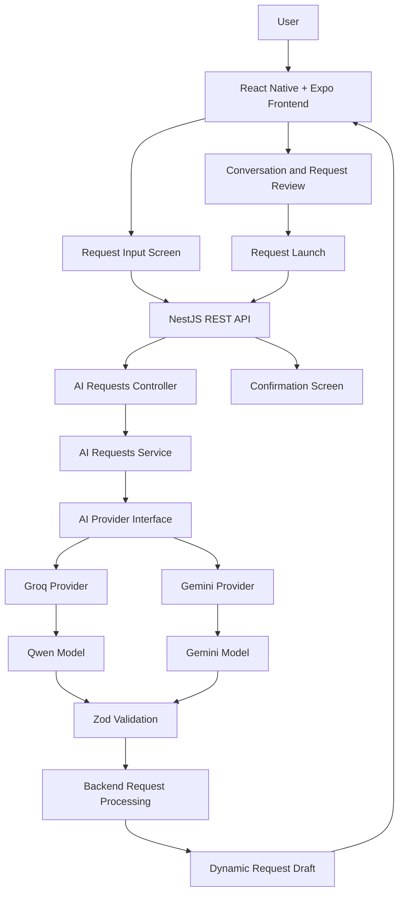
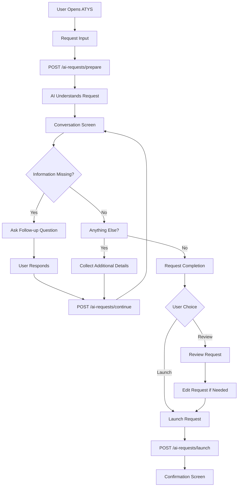
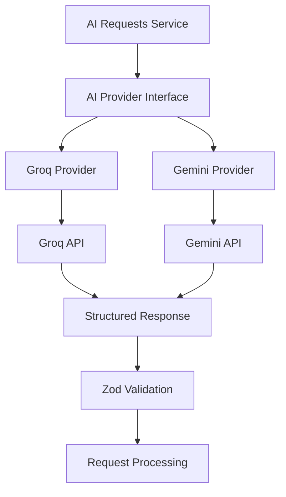

# ATYS AI Request Agent

**An AI-powered conversational request assistant for ATYS (At Your Service).**

ATYS AI Request Agent is a mobile-first application that allows users to describe what they need in natural language. Instead of navigating complicated service categories or filling out predefined forms, users simply explain their requirements, answer relevant follow-up questions, review the generated request, and submit it.

The system combines a React Native mobile frontend with a NestJS backend powered by AI models to transform unstructured user input into structured requests.

---

## Table of Contents

1. [Project Overview](#project-overview)
2. [Key Features](#key-features)
3. [System Architecture](#system-architecture)
4. [Technology Stack](#technology-stack)
5. [Project Structure](#project-structure)
6. [Application Workflow](#application-workflow)
7. [Backend Architecture](#backend-architecture)
8. [API Documentation](#api-documentation)
9. [AI Processing](#ai-processing)
10. [Getting Started](#getting-started)
11. [Frontend Configuration](#frontend-configuration)
12. [Backend Configuration](#backend-configuration)
13. [Running the Application](#running-the-application)
14. [Development Status](#development-status)
15. [Current Limitations](#current-limitations)
16. [Future Improvements](#future-improvements)

---

## Project Overview

The ATYS AI Request Agent is designed to simplify how users request everyday assistance, professional services, and product purchases.

Users can express their requirements naturally, even when their messages are incomplete or unclear.

**Example:**

User:

> I need someone to repair my AC. It isn't cooling.

ATYS AI Agent:

1. Understands the request as a professional service.
2. Identifies the service as AC repair.
3. Generates an appropriate request title.
4. Identifies missing information, such as location.
5. Asks relevant follow-up questions.
6. Updates the request as the user responds.
7. Generates a structured request for review.
8. Allows the user to edit or launch the request.

The system dynamically determines which information is relevant instead of relying on fixed request templates.

### Project Goal

Make requesting help as simple as explaining what you need.

---

## Key Features

### AI Request Understanding
- Converts natural-language messages into structured requests.
- Identifies request categories and relevant information.
- Handles incomplete and ambiguous requests.
- Generates meaningful request titles.

### Conversational Interaction
- Asks relevant follow-up questions.
- Maintains conversation context.
- Updates request drafts based on user responses.
- Supports additional information before completion.

### Dynamic Request Management
- Generates request fields according to the actual requirement.
- Identifies missing information.
- Determines when a request is ready for review.
- Supports individual field editing.

### Request Submission
- Provides a request review screen.
- Allows direct launch or review before submission.
- Prevents duplicate submissions through loading states.
- Displays confirmation after successful submission.

### Multilingual Support
Designed to understand:
- English
- Urdu
- Roman Urdu

### Mobile Experience
- React Native and Expo-based mobile application.
- Responsive layouts for different screen sizes.
- Reusable UI components.
- Dedicated screens for each stage of the request lifecycle.

---

## System Architecture

The system consists of two main applications:

1. **Frontend:** React Native mobile application.
2. **Backend:** NestJS REST API with AI provider integration.



### Architectural Responsibilities

| Layer | Responsibility |
|---|---|
| React Native frontend | User interface and interaction |
| Expo Router | Screen navigation |
| Custom conversation hook | Conversation state and flow |
| API service | HTTP communication |
| NestJS controllers | API request handling |
| AI request service | Request processing and orchestration |
| AI providers | Communication with AI models |
| Zod validation | Structured response validation |
| Backend business logic | Draft updates and readiness decisions |

The backend remains the source of truth for request fields, missing information, follow-up questions, and readiness.

---

## Technology Stack

### Frontend

| Technology | Purpose |
|---|---|
| React Native | Mobile application development |
| Expo | Development and build environment |
| Expo Router | File-based navigation |
| TypeScript | Type-safe development |
| Axios | HTTP communication |

### Backend

| Technology | Purpose |
|---|---|
| Node.js | JavaScript runtime |
| NestJS | Backend application framework |
| TypeScript | Type-safe development |
| Groq API | AI inference |
| Qwen Model | Natural-language request processing |
| Google Gemini API | Alternative AI provider |
| Zod | Runtime schema validation |

---

## Project Structure

The project is maintained as two separate applications.

```text
ATYS/
│
├── atys-frontend/
│   │
│   ├── app/
│   │   ├── index.tsx
│   │   ├── response.tsx
│   │   ├── review.tsx
│   │   └── confirmation.tsx
│   │
│   ├── components/
│   │   ├── request/
│   │   │   ├── ChatMessage.tsx
│   │   │   ├── RequestCard.tsx
│   │   │   ├── AnythingElseOptions.tsx
│   │   │   └── RequestCompletion.tsx
│   │   │
│   │   └── ui/
│   │       ├── Button.tsx
│   │       └── TextInput.tsx
│   │
│   ├── hooks/
│   │   └── useConversation.ts
│   │
│   ├── services/
│   │   └── api.ts
│   │
│   ├── types/
│   │   └── api.ts
│   │
│   ├── utils/
│   │   └── requestNavigation.ts
│   │
│   ├── constants/
│   │   └── Config.ts
│   │
│   ├── assets/
│   ├── package.json
│   └── README.md
│
├── atys-backend/
│   │
│   ├── src/
│   │   ├── main.ts
│   │   ├── app.module.ts
│   │   │
│   │   └── ai-requests/
│   │       ├── ai-requests.module.ts
│   │       ├── ai-requests.controller.ts
│   │       ├── ai-requests.service.ts
│   │       │
│   │       └── providers/
│   │           ├── ai-provider.interface.ts
│   │           ├── groq.provider.ts
│   │           └── gemini.provider.ts
│   │
│   ├── package.json
│   ├── tsconfig.json
│   └── .env
│
└── README.md
```

*Note: The backend tree illustrates the reported architecture. Adjust individual filenames and locations to match the actual repository.*

### Frontend Directory Responsibilities

| Directory | Responsibility |
|---|---|
| `app/` | Main application screens |
| `components/request/` | Request-specific UI components |
| `components/ui/` | Reusable interface components |
| `hooks/` | Conversation state and logic |
| `services/` | API communication |
| `types/` | TypeScript interfaces |
| `utils/` | Navigation and data utilities |
| `constants/` | Application configuration |

### Backend Directory Responsibilities

| Directory | Responsibility |
|---|---|
| `src/` | Main NestJS application |
| `ai-requests/` | Request processing module |
| `providers/` | AI provider implementations |
| `ai-requests.controller.ts` | REST API endpoints |
| `ai-requests.service.ts` | AI request orchestration |
| `ai-provider.interface.ts` | Provider abstraction |
| `groq.provider.ts` | Groq API integration |
| `gemini.provider.ts` | Gemini API integration |

---

## Application Workflow

The request lifecycle is divided into six stages.



### 1. Request Input

The user describes what they need using natural language.

The frontend sends the initial message to the backend.

### 2. AI Request Processing

The backend analyzes the message and generates a structured request draft.

It identifies:
- Request category.
- Request title.
- Relevant information.
- Missing fields.
- Next follow-up question.
- Current readiness status.

### 3. Conversational Follow-ups

The user answers the AI-generated questions.

Each response is sent to the backend, which updates the request draft.

### 4. Additional Information

After collecting the required information, the agent asks whether the user wants to add anything else.

- Yes: The user provides additional information.
- No: The request moves to completion.

### 5. Request Review

The user can inspect the generated request and edit individual fields.

The backend processes corrections and returns the updated draft.

### 6. Request Launch

The user can launch directly or after reviewing the request.

After successful backend submission, the frontend displays the confirmation screen.

---

## Backend Architecture

### AI Provider Abstraction

The backend supports multiple AI providers through a shared provider interface.

This allows the application to switch providers without rewriting the core request-processing service.



### Supported Providers

| Provider | Purpose |
|---|---|
| Groq | Primary configured AI provider |
| Google Gemini | Alternative AI provider |

The active provider is selected using environment configuration.

```env
AI_PROVIDER=groq
```

### Request Categories

The backend currently supports these categories:

| Category | Description |
|---|---|
| `professional_service` | Professional services such as AC repair, plumbing, and electrical work |
| `general_assistance` | Everyday tasks such as moving, lifting, and errands |
| `product_purchase` | Requests to purchase products or groceries |
| `other` | Requests outside the above categories |

The fields are determined dynamically according to the user's actual requirements.

### Request Statuses

| Status | Meaning |
|---|---|
| `needs_clarification` | More information is required |
| `ready_for_review` | Sufficient information has been collected for review |

The backend determines request readiness rather than relying on fixed frontend rules.

---

## API Documentation

The frontend communicates with the backend through REST API endpoints.

### Health Check

```http
GET /health
```

Checks whether the backend application is running.

### Prepare Request

```http
POST /ai-requests/prepare
```

Processes the user's initial request.

Responsibilities:
- Understand the user's message.
- Identify the request category.
- Generate a title.
- Extract relevant information.
- Identify missing fields.
- Generate the next follow-up question.
- Return the initial request draft.

### Continue Request

```http
POST /ai-requests/continue
```

Processes additional information supplied by the user.

Responsibilities:
- Receive the current request draft.
- Process the user's response.
- Update relevant fields.
- Preserve previously collected information.
- Recalculate missing information.
- Generate the next follow-up question.
- Determine request readiness.

This endpoint also handles additional information and field corrections.

### Launch Request

```http
POST /ai-requests/launch
```

Submits the completed request draft.

Responsibilities:
- Receive the latest request draft.
- Validate request readiness.
- Process the launch operation.
- Return a submission response.

Provider matching and task fulfillment are outside the current AI Request Agent implementation.

---

## AI Processing

The AI request-processing service follows a structured pipeline:

1. Receive user input.
2. Build the prompt using conversation context.
3. Send the prompt to the configured AI provider.
4. Receive structured output.
5. Validate the response using Zod.
6. Merge the extracted information into the request draft.
7. Calculate missing fields.
8. Determine readiness.
9. Return the updated response.

### Structured Response Validation

Zod is used to validate AI-generated responses before they are processed further.

This helps prevent malformed AI output from entering the application's request flow.

### Multilingual Understanding

The agent is designed to understand natural-language requests in:
- English
- Urdu
- Roman Urdu

The user should be able to express requirements naturally without needing to follow a strict input format.

---

## Getting Started

### Prerequisites

Install the following:

- Node.js
- npm
- Git
- Android Studio and Android Emulator, or a compatible physical device
- Groq API key or Gemini API key

### 1. Clone the Repository

```bash
git clone <YOUR_REPOSITORY_URL>
```

### 2. Navigate to the Project

```bash
cd ATYS
```

### 3. Install Frontend Dependencies

```bash
cd atys-frontend
npm install
```

### 4. Configure the Frontend

Open:

```text
constants/Config.ts
```

Configure the backend URL.

### 5. Install Backend Dependencies

Open another terminal:

```bash
cd atys-backend
npm install
```

### 6. Configure Backend Environment Variables

Create a `.env` file in the backend root directory.

Example Groq configuration:

```env
PORT=3000

AI_PROVIDER=groq
GROQ_API_KEY=your_groq_api_key
GROQ_MODEL=qwen/qwen3.8-27b

APP_TIMEZONE=Asia/Karachi
```

For Gemini:

```env
AI_PROVIDER=gemini
GEMINI_API_KEY=your_gemini_api_key
GEMINI_MODEL=your_gemini_model
```

Use the actual model identifier configured in your project.

**Important:** Never commit API keys or `.env` files to GitHub.

---

## Running the Application

Both applications must be running simultaneously.

### Start the Backend

From the backend directory:

```bash
npm run start:dev
```

The backend should be accessible at:

```text
http://localhost:3000
```

Check its health:

```text
http://localhost:3000/health
```

### Start the Frontend

From the frontend directory:

```bash
npx expo start
```

Open the application using your Android emulator or compatible development environment.

### Backend URL Configuration

For Android Emulator:

```typescript
export const API_BASE_URL = "http://10.0.2.2:3000";
```

For a physical Android device, use your computer's reachable local network IP address.

Make sure both devices are connected to the appropriate network and the backend accepts the connection.

---

## Development Status

| Component | Status |
|---|---|
| React Native frontend | Implemented |
| NestJS backend | Implemented |
| AI provider abstraction | Implemented |
| Groq integration | Implemented |
| Gemini provider | Implemented |
| Natural-language request processing | Implemented |
| Dynamic request generation | Implemented |
| Conversational follow-ups | Implemented |
| Additional information flow | Implemented |
| Request review and editing | Implemented |
| Request launch endpoint | Implemented |
| Confirmation screen | Implemented |
| Frontend architecture refactoring | Completed |
| Navigation data hardening | Completed |
| UI/UX visual refinement | In progress |
| Comprehensive end-to-end testing | Pending |

*Status reflects the current development implementation and reported verification. It does not imply production deployment or complete end-to-end certification.*

---

## Current Limitations

- Backend conversation state is maintained in memory and is not persistent across server restarts.
- PostgreSQL and Prisma integration are planned but not yet integrated.
- User authentication and authorization are not yet integrated into the request-agent backend.
- Provider discovery, matching, messaging, and task fulfillment are not implemented by this agent.
- Voice-based request interaction remains a future improvement.
- Production monitoring, deployment, and recovery mechanisms are still planned.
- Full end-to-end reliability testing is pending.

---

## Future Improvements

### Frontend
- Refined UI/UX design.
- Voice-based request input.
- Improved multilingual experience.
- Better accessibility and interaction feedback.
- Improved loading and error experiences.

### Backend
- PostgreSQL and Prisma integration.
- Persistent request and conversation storage.
- Authentication and authorization.
- Improved AI timeout and retry handling.
- Conversation recovery.
- Production monitoring and deployment.

### ATYS Platform Integration
- Provider discovery and matching.
- Provider acceptance and task management.
- Client-provider communication.
- Complete request fulfillment lifecycle.

---

## Project Context

ATYS (At Your Service) is a hyperlocal assistance platform designed to connect people who need help with suitable local helpers and professional service providers.

The AI Request Agent is an important part of this platform. It simplifies the process of describing a requirement and converts natural-language input into a structured request.

The frontend provides the conversational user experience, while the backend handles AI-powered understanding, request processing, validation, and submission.

**The goal is simple: Users explain what they need. ATYS helps turn it into a clear, structured request.**

---

## License

This project is currently under development. Licensing and distribution terms will be defined by the project owner.
